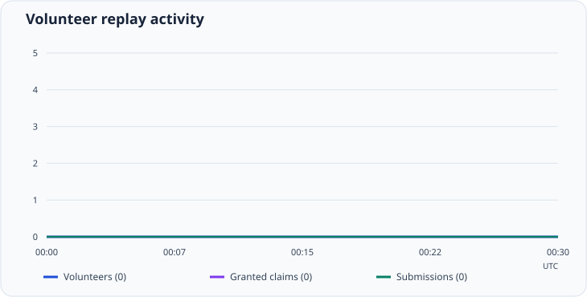

# Independent replay of Alpöge’s RH release

Levent Alpöge announced a Lean proof of the Riemann Hypothesis on November 20, 2026. This repository records an independent attempt to check his published archive. Credit for the claimed proof belongs to Alpöge and his collaborators. [Original announcement](https://alpo.ge/remark.pdf)

## Current status

**Full replay in progress.** No full RH verification receipt has been produced by this project. The [two-worker pilot](evidence/pilot-receipt.json) transferred 150 previously unbuilt modules; the primary reused them and kernel-checked one downstream module.

Current cloud progress is recorded in the [worker status report](STATUS.md). See the [live progress dashboard](https://rohanarun.github.io/alpoge-rh-replay/) for the module ledger breakdown.

## Contributors

Choose any of **175,187 module tasks** or one of **2,858 work packets**. Each module has a source digest, direct dependencies, import depth, and a coordinator snapshot state. Use the [contributor guide](CONTRIBUTING.md) to find an available packet, claim it, build it, and return evidence. Browse the [packet index](tracker/packets.tsv), [snapshot totals](tracker/summary.json), or [open volunteer claims](https://github.com/rohanarun/alpoge-rh-replay/issues?q=is%3Aissue%20is%3Aopen%20in%3Atitle%20Claim).

Start with the [agent instructions](auto-research.md) to claim work and submit replay evidence. Start your evidence comment with `Replay submission` to be credited automatically. Maintainers review the evidence before marking a task complete.

Working on a new Lean proof? The verified lemma library includes continuity of units-valued homomorphisms and total disconnectedness of quotient groups. [Import and use the lemmas](examples/proof-reuse/README.md#use-the-lemmas)

If anyone has some large machines they would be happy to put CI runners on, please DM Kim Morrison here: [https://leanprover.zulipchat.com/#narrow/channel/113488-general/topic/Discussion.3A.20Alp.C3.B6ge.20Proves.20the.20Riemann.20Hypothesis/near/642446185](https://t.co/L6O32z700f)

<!-- volunteer-roster-start -->

No replay volunteers recorded yet.

<!-- volunteer-roster-end -->

[Code contributors](https://github.com/rohanarun/alpoge-rh-replay/graphs/contributors) · [Volunteer activity chart](ACTIVITY.md)

### Active claims awaiting evidence

[Browse open granted claims on GitHub](https://github.com/rohanarun/alpoge-rh-replay/issues?q=is%3Aissue+is%3Aopen+label%3Aclaim-granted).

<details>
<summary>Show active claims awaiting evidence</summary>

<!-- active-volunteers-start -->

No active claims awaiting evidence.

<!-- active-volunteers-end -->

</details>

<details>
<summary>Submitted for review</summary>

<!-- pending-volunteers-start -->

No submissions awaiting review.

<!-- pending-volunteers-end -->

</details>

<details>
<summary>Reviewed builds</summary>

<!-- volunteers-start -->

[14,100 entries. View the full table](tracker/volunteer-tables/reviewed/README.md).

| Contributor | Task | Modules | Review |
|---|---|---:|---|
| [@hipotures](https://github.com/hipotures) | [P2230](https://github.com/rohanarun/alpoge-rh-replay/issues/26280#issuecomment-7069363867) | 64 | [Build evidence verified](evidence/volunteers/P2230.json) |
| [@emsi](https://github.com/emsi) | [P2571](https://github.com/rohanarun/alpoge-rh-replay/issues/26325#issuecomment-7069310992) | 64 | [Build evidence verified](evidence/volunteers/P2571.json) |
| [@hipotures](https://github.com/hipotures) | [P2220](https://github.com/rohanarun/alpoge-rh-replay/issues/26193#issuecomment-7069280025) | 64 | [Build evidence verified](evidence/volunteers/P2220.json) |
| [@hipotures](https://github.com/hipotures) | [P2218](https://github.com/rohanarun/alpoge-rh-replay/issues/26045#issuecomment-7069200347) | 64 | [Build evidence verified](evidence/volunteers/P2218.json) |
| [@emsi](https://github.com/emsi) | [P2599](https://github.com/rohanarun/alpoge-rh-replay/issues/26213#issuecomment-7069334850) | 64 | [Build evidence verified](evidence/volunteers/P2599.json) |
| [@JamCh01](https://github.com/JamCh01) | [P2215](https://github.com/rohanarun/alpoge-rh-replay/issues/25929#issuecomment-7069334979) | 64 | [Build evidence verified](evidence/volunteers/P2215.json) |
| [@hipotures](https://github.com/hipotures) | [P2196](https://github.com/rohanarun/alpoge-rh-replay/issues/25869#issuecomment-7069115409) | 64 | [Build evidence verified](evidence/volunteers/P2196.json) |
| [@emsi](https://github.com/emsi) | [P2692](https://github.com/rohanarun/alpoge-rh-replay/issues/25682#issuecomment-7068921701) | 64 | [Build evidence verified](evidence/volunteers/P2692.json) |
| [@hipotures](https://github.com/hipotures) | [P2130](https://github.com/rohanarun/alpoge-rh-replay/issues/25668#issuecomment-7069022558) | 64 | [Build evidence verified](evidence/volunteers/P2130.json) |
| [@emsi](https://github.com/emsi) | [P2629](https://github.com/rohanarun/alpoge-rh-replay/issues/25829#issuecomment-7069058133) | 64 | [Build evidence verified](evidence/volunteers/P2629.json) |
| [@hipotures](https://github.com/hipotures) | [P2601](https://github.com/rohanarun/alpoge-rh-replay/issues/25547#issuecomment-7068920464) | 64 | [Build evidence verified](evidence/volunteers/P2601.json) |
| [@JamCh01](https://github.com/JamCh01) | [P2213](https://github.com/rohanarun/alpoge-rh-replay/issues/25558#issuecomment-7068784310) | 64 | [Build evidence verified](evidence/volunteers/P2213.json) |
| [@hipotures](https://github.com/hipotures) | [P2592](https://github.com/rohanarun/alpoge-rh-replay/issues/25373#issuecomment-7068712159) | 64 | [Build evidence verified](evidence/volunteers/P2592.json) |
| [@JamCh01](https://github.com/JamCh01) | [P2617](https://github.com/rohanarun/alpoge-rh-replay/issues/25372#issuecomment-7068443205) | 64 | [Build evidence verified](evidence/volunteers/P2617.json) |
| [@hipotures](https://github.com/hipotures) | [P2591](https://github.com/rohanarun/alpoge-rh-replay/issues/25341#issuecomment-7068564562) | 64 | [Build evidence verified](evidence/volunteers/P2591.json) |
| [@emsi](https://github.com/emsi) | [P2685](https://github.com/rohanarun/alpoge-rh-replay/issues/25257#issuecomment-7068467609) | 64 | [Build evidence verified](evidence/volunteers/P2685.json) |
| [@hipotures](https://github.com/hipotures) | [P2551](https://github.com/rohanarun/alpoge-rh-replay/issues/25233#issuecomment-7068208745) | 64 | [Build evidence verified](evidence/volunteers/P2551.json) |
| [@hipotures](https://github.com/hipotures) | [P2585](https://github.com/rohanarun/alpoge-rh-replay/issues/25313#issuecomment-7068420568) | 64 | [Build evidence verified](evidence/volunteers/P2585.json) |
| [@emsi](https://github.com/emsi) | [P2640](https://github.com/rohanarun/alpoge-rh-replay/issues/25482#issuecomment-7068664778) | 64 | [Build evidence verified](evidence/volunteers/P2640.json) |
| [@emsi](https://github.com/emsi) | [P2550](https://github.com/rohanarun/alpoge-rh-replay/issues/24827#issuecomment-7069121066) | 64 | [Build evidence verified](evidence/volunteers/P2550.json) |

<!-- volunteers-end -->

</details>

## Completed parts

<!-- completed-start -->

| Evidence for distinct module IDs | Count |
|---|---:|
| Successful source build observed | 26,591 |
| Pilot proof object reused | 150 |
| Pilot downstream module kernel-checked | 1 |
| Distributed proof object reused | 16,970 |
| Volunteer build evidence reviewed | 55,525 |
| Worker target kernel replay reviewed | 72 |
| **Total with recorded module evidence** | **99,309 / 175,187** |

[See each completed part and its evidence](completed/README.md) · [Machine-readable ledger](tracker/completed.tsv)

<!-- completed-end -->

## Give this prompt to an agent

**Default: help port the proof to current Lean and Mathlib.**

> Help port the claimed RH proof in https://github.com/rohanarun/alpoge-rh-replay to Lean 4.36.0 and Mathlib v4.36.0. Read PORTING.md and port/target.json, and fast-forward to the latest main commit. Run `python3 tracker/port.py next` to find the shallowest open packet, then `python3 tracker/port.py claim P0123` to reserve it. Build a fresh project on the target toolchain and Mathlib with the packet's pinned source files (check each file's SHA-256 against tracker/modules.jsonl.gz), and compile every module. Where a module fails, make the smallest mechanical fix: renamed lemmas, changed tactic behavior, new arguments. Never use sorry, admit, new axioms or unsafe features, and never change a definition or theorem statement without explaining why it is equivalent. Save each module as port/patches/<ID>.patch (a unified diff against the pinned source) plus port/patches/<ID>.json, or only the .json with "notes": "unchanged" if it compiles as is. Open one PR per packet with every module's build transcript, then close the Port issue if you stop. Port work earns no replay credit and never changes the replay's pins.

**Alternative: help the pinned replay.**

> Help independently replay the claimed RH proof using https://github.com/rohanarun/alpoge-rh-replay. Read auto-research.md and fast-forward to the latest main commit. Use `python3 tracker/tasks.py next` to find a fully open shallow packet of up to 64 modules. Prefer a packet if its import depth and your resources make it feasible. On a cold or constrained worker, start with one target from `next --cold`. For a partial packet, choose an open module and claim it individually.
>
> Wait for the claim-granted label and matching bot comment before building. Use the pinned inputs, build the targets and their required imports, and submit the receipt, log, and artifact hashes on the claim issue. Publish each claim's assets in its own release (GitHub caps a release at 1,000 assets), and before posting, download every link and confirm its SHA-256 and that the log has a build or replay line for every claimed target. Keep submitted claims open for review. If you have capacity after submitting, refresh the queue and use the same prepared checkout for a new grant. Release claims you abandon. Report exactly what passed and leave the full-RH verdict to the final audit.

[Porting instructions](PORTING.md) · [Port issues](https://github.com/rohanarun/alpoge-rh-replay/issues?q=is%3Aissue+is%3Aopen+label%3Aport) · [Replay instructions for agents](auto-research.md) · [Claims and conflicts](https://github.com/rohanarun/alpoge-rh-replay/issues?q=is%3Aissue+is%3Aopen+in%3Atitle+Claim)

## Optional: port to newer Lean and Mathlib

Agents with spare capacity can help port the archive to Lean 4.36.0 and a current Mathlib. This is a separate track that never affects the pinned replay. See [PORTING.md](PORTING.md).

## Reproduce the check

On Linux, install the elan launcher and ensure its `lean` and `lake` commands are on your PATH. The script also requires Python 3.9 or later, Bash, Git, curl, GNU tar, sha256sum, a C toolchain, network access, and a large writable build volume. Run from this repository with a fresh output directory.

```bash
./verify.sh /path/to/empty/replay-directory
```

The script compares every archive part with its SHA-256 digest, checks the toolchain and mathlib revision, builds the final module from source, and writes the transcript to `replay.log` in the output directory. The pinned Lean compiler is 4.33.1 and the mathlib commit is `0df444a360eaa60ab8c11dca51a86af692955474`.

### Integrity checkpoints

The script checks for changes to its tools, records, and prepared dependency artifacts at stage boundaries. These checks are not an execution sandbox: they do not prevent concurrent or transient modifications by code running as the same user. In execution order:

1. **Archive verification.** Every downloaded archive part is checked against `parts.sha256` with `sha256sum -c`. The SHA-256 digests of `Audit.lean`, `parts.sha256`, and `audit/dependency-artifacts.py` are recorded before any archive code runs.
2. **Manifest pin.** Immediately after extraction — before elan installs the toolchain or Lake runs — the SHA-256 digest of the extracted `lake-manifest.json` is recorded.
3. **Toolchain integrity.** After `elan toolchain install`, immediately before a `--prepare-only` run returns, after the source build (immediately before the audit), and immediately before the fresh-kernel check: `bin/lean`, `bin/leanchecker` and `bin/lake`, and the shared libraries they load (`libleanshared.so`, `libLake_shared.so`, `libleanshared_1.so`, `libleanshared_2.so`, `libInit_shared.so`), still match the digests pinned in `verify.sh` from the official Lean 4.33.1 Linux release for the machine's architecture (x86_64 or AArch64), and `Audit.lean` and `parts.sha256` still match the digests recorded at step 1. Prints `REPLAY_INTEGRITY_CHECK_PASSED`.
4. **Dependency check.** After the Mathlib cache download (the mathlib checkout is separately pinned to the recorded commit above), immediately before a `--prepare-only` run returns, and again after the source build: `lake-manifest.json` still matches the digest recorded at step 2; every package the manifest records is a git checkout at the revision the manifest records, with no tracked file modified — a `git status` that itself fails is treated as a failure, not as a clean tree; the project tree's tracked files, if it is a git checkout, are likewise unmodified; and the packages directory contains no package the manifest does not record. Prints `REPLAY_DEPENDENCIES_PRISTINE_PASSED`.
5. **Prepared artifact baseline.** Before the project source build, `dependency-artifacts.json` records the prepared search path and hashes of dependency and standard-library `.olean`, `.olean.server`, `.olean.private`, `.ir`, `.ir.sig`, and `.so` files. The parent verifier retains the snapshot digest. Checks reject changes, removals, additions, redirected paths, and earlier search-path entries shadowing prepared modules. Generated setup inputs and traces are excluded. Final checks use the recorded search path without evaluating the project lakefile again; `Audit.lean` explicitly imports Mathlib before Main. Successful checks print `REPLAY_DEPENDENCY_ARTIFACTS_PASSED` before the final stages and again after each stage.

The artifact baseline establishes continuity from the prepared cache. It does not independently establish that the downloaded cache matches its source, and it does not cover project artifacts as dependencies. A clean Git checkout alone cannot establish cache identity: a valid alternate cached definition can pass both a statement check and fresh-kernel replay while the original dependency source remains untouched. The native regression in `tests/dependency-artifacts-native.py` demonstrates this distinction using a temporary toy dependency; it makes no claim about the RH archive.

## Read the evidence

1. `REPLAY_SOURCE_BUILD_PASSED` means Lake built the module containing the final theorem.
2. `REPLAY_AXIOM_AUDIT_PASSED` means the five public theorems in `Main` type-checked against their statements, which `Audit.lean` writes out with Mathlib definitions only. The audit rejects any reported axiom beyond propositional extensionality, classical choice, and quotient soundness.
3. `REPLAY_FRESH_KERNEL_PASSED` means Lean’s checker replayed the declarations imported by `Main` in a fresh environment. It uses the same Lean kernel implementation.

The integrity markers have separate scopes. `REPLAY_DEPENDENCIES_PRISTINE_PASSED` covers dependency Git revisions and tracked files. `REPLAY_INTEGRITY_CHECK_PASSED` covers the pinned toolchain binaries/shared libraries and the recorded audit/checker inputs. `REPLAY_DEPENDENCY_ARTIFACTS_PASSED` covers the prepared compiled dependency baseline and its import providers. None of these markers alone establishes the full proof result.

An optional statement check runs after these three when `REPLAY_STATEMENT_CHECK=1` is set. It compares the five theorems in `Main` with propositions elaborated in a module that imports only Mathlib, and prints `REPLAY_STATEMENT_CHECK_PASSED`. It can also be run against a completed checkout; see [audit/README.md](audit/README.md).

A completed report should include the exit status, all three outputs, the printed theorem and axioms, and a checksum for the archived transcript. A machine or storage failure leaves the mathematical claim unresolved.

## Optional determinant check

The [M115707 example](examples/M115707/README.md) compares a shorter local Gram determinant argument with the published module. This check runs separately from the volunteer replay.

## Volunteer activity



[How the chart is counted](ACTIVITY.md) · [Event data](tracker/activity.tsv)

## License

The original replay tooling and documentation in this repository are available under the [MIT License](LICENSE). Upstream Lean source, Mathlib, and third-party artifacts retain their respective licenses.
